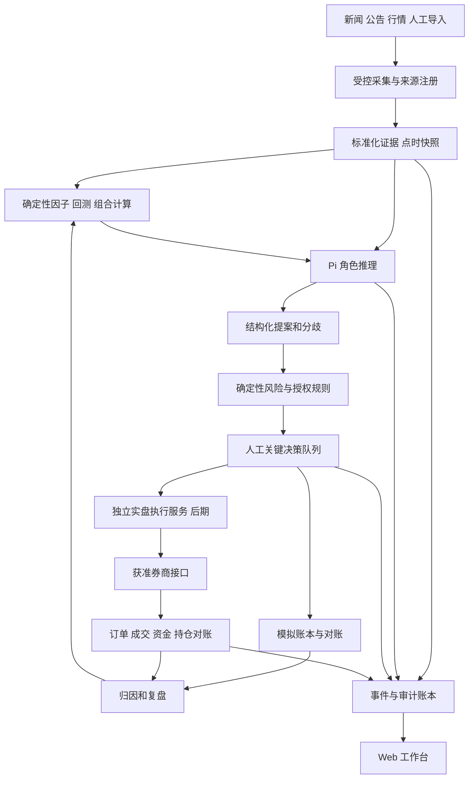

# AI 量化投资工作台：产品、架构与 Zcode 实施总方案

编制日期：2026-09-18。状态：规划交付，尚未实施或启用新系统。

本文件面向项目所有者与 Zcode。目标市场先限定中国 A 股、中证 500 研究范围，首发采用日频、低频调仓、自有账户场景。具体投资品种、资金规模与风险限额留给所有者配置；本文不提供个股或真实资金买卖建议。工期、容量和验收数字均为本项目建议目标，不是已实现指标。

## 1. 结论与产品目标

建设一个“你做关键决策、AI 承担大部分研究和方案生成、规则系统执行约束”的量化投资工作台。

完整业务闭环是：新闻与公告进入 → 事实核验与股票映射 → 因子与事件分析 → 策略实验 → 组合方案 → 确定性风控 → 人工决策 → 模拟执行 → 对账与复盘 → 在独立验收后接入真实账户。

优先交付三个可使用的产品：

1. **情报与 Agent 工作台**：看清新闻来源、代理任务、意见分歧、成本，以及需要你处理的问题。
2. **研究与模拟投资工作台**：能冻结策略、重放历史、比较基线、模拟成交、解释收益和风险。
3. **受控投资执行工作台**：先只读账户，再逐批人工批准，最后才考虑在固定授权范围内自动执行。

工业级在这里指数据可追溯、任务可恢复、权限真实有效、订单可对账、故障会停止、版本能回滚。它不等于多装插件、不等于 Agent 数量多，也不承诺盈利。

### 1.1 本次已经作出的设计决定

| 决定 | 原因 | 后续如何验证 |
|---|---|---|
| 保留 Pi，Python 负责业务状态和计算 | 当前已有隔离调用与确定性引擎 | 真实代理调用日志、契约测试 |
| 建立独立投资工作区，当前库保留研究定位 | 旧 ADR 明确永久禁止券商与模拟交易服务 | 新项目 charter、依赖边界测试 |
| 先日频，不做高频 | 免费资讯的时效与可靠性不适合低延迟执行 | 数据延迟统计、样本外与影子运行 |
| 免费数据优先，但不承诺全链路免费 | 新闻权利、历史行情完整性、模型和运维均有成本 | 来源合同/条款、每日费用账单 |
| 前端自建，复用小型组件 | 避免引入 OpenClaw、整套外部业务模型和许可证冲突 | 页面验收、依赖清单 |
| 核心账本用 PostgreSQL，历史分析用 Parquet/DuckDB | 区分交易状态一致性与分析查询 | 并发、恢复和数据迁移测试 |
| 第一阶段只有一套编排状态机 | 避免 Pi、LangGraph、Dagster 各自控制重试和状态 | 故障注入、幂等测试 |
| 首个可用成果是新闻→代理→人工队列的纵向闭环 | 先证明使用价值 | 用户用真实案件完成复核 |

### 1.2 首版不纳入

高频交易、期权衍生品、融资融券、自动改生产代码、自动扩张资金、多个券商并行、面向公众的荐股服务、多租户 SaaS、移动原生 App。支持浏览器响应式使用即可。

## 2. 现有项目现场调查

### 2.1 本次核对到的事实

当前目录：`E:\闲鱼\codex openclaw`。

| 能力 | 实际文件/证据 | 判断 |
|---|---|---|
| Pi 调用 | `quant_agents/pi_client.py` | 调用命令、环境变量白名单、关闭工具/扩展/skills 等控制已存在 |
| 七代理流水线 | `quant_agents/orchestrator.py`、`agents/` | 有运行状态、preflight、产物和报告 |
| Tushare | `quant_agents/data_client.py` | 当前单一供应商实现，含日历、历史成分、行情等 |
| 确定性量化 | `research_engine.py`、`market_rules.py`、`backtest_assurance.py` | 可优先封装复用，不应全部重写 |
| 证据与恢复 | `audit.py`、`release.py`、`operations.py` | 有哈希、manifest、归档验证和恢复相关功能 |
| UI/新闻/API 服务 | 主包目录与直接依赖清单 | 当前主项目没有完整投资 Web 工作台，也没有本方案新闻服务 |
| 最近记录 | `governance/project_execution_status.json` | 2026-09-15 记录 194 项测试、Mock 7/7、G0、BLOCKED |
| 最近 Mock | `runs/20260915_013055_711/summary.md` | 合成数据与模拟推理，不能证明真实投资效果 |
| Git | 本次 `git rev-parse --verify HEAD` 失败 | 没有可用提交基线；不可声称可复现发布 |

本次是代码和文档调查，没有重新跑完整测试，没有用现存密钥调用模型，没有验证券商账户，也没有重新认证这些数据接口在本机的可达性。194 项通过是 9 月 15 日已有记录，不是 9 月 18 日新跑结果。

### 2.2 必须解决的目标冲突

旧 `docs/adr/ADR-0006-no-broker-or-live-execution.md` 不仅禁止实盘，还拒绝独立纸面撮合服务。旧 `ADR-0007` 把多数据源抽象推迟到后期。新需求要新闻、投资决策、面板和最终实盘，不能继续沿用旧路线并声称已经满足。

处理方案：

1. 本轮只新增规划文档，旧运行边界保持原状。
2. Zcode 在独立目录 **建议 `E:\quant-investment-workbench`** 建立新产品；目录目前只是建议，创建前检查存在情况。
3. 当前库作为只读研究资产来源；经测试后选择性提取为内部版本包，不把新项目的券商凭据写回这里。
4. 新项目写自己的 charter 和 ADR，明确支持 research、paper、shadow、live 四种模式；旧项目约束不通过批量替换字符串解除。
5. 多源数据适配提前进入新项目 P1；历史数据、点时语义与许可控制保持一致。
6. 将个人自用与机构多人运营分开。个人版由你承担 Owner/操作人，保留真实授权和审计，不虚构九个人或用多个 AI 冒充独立审批；机构版再按实际组织执行职责分离。

新目标允许规划投资执行，但不是本轮启用真实订单的授权。旧仓库源码审查包也只证明旧候选树；加入本文后，旧扫描回执与 packet 不应继续当作当前全树证明，后续发布应重建。

## 3. 本地资产复用清单

本次仅阅读以下相关目录，未复制密钥、运行数据或审批原件，未扫描无关个人文件。

| 本地路径 | 核查内容 | 推荐复用 | 不直接搬入 |
|---|---|---|---|
| `E:\闲鱼\codex openclaw` | 上述量化主包、Pi、治理文件 | 回测计算、数据快照、Pi 适配、审计和测试样例 | 旧产品禁止投资的业务流程、缓存、凭据 |
| `E:\stock agent` | README、sources、models、dashboard 等 | 新闻标准化、RSS、来源健康、复核队列、证据链、备份思路 | 整套机构审批流程和现有生产状态 |
| `E:\GitHub\pi` | monorepo package.json | Pi API/事件协议研究，版本兼容核对 | 本地源码直接替换已锁定 runtime |
| `E:\GitHub\pi-subagents` | README | 开发阶段 scout/reviewer 等工作流 | 投资运行中动态生成无限子代理 |
| `E:\GitHub上下载的\AI Hedge FundAI对冲基金github项目\ai-hedge-fund-main\ai-hedge-fund-main` | README | 专业角色、结果展示、组合提案的交互参考 | 名人代理、默认美股数据、其结论作为实盘依据 |
| `E:\GitHub上下载的\openstock\OpenStock-main\OpenStock-main` | README、LICENSE | 自选列表、详情页、看板的信息组织 | 直接复制 AGPL 项目代码进拟闭源产品 |
| `E:\openclaw-mission-control-master\openclaw-mission-control-master` | README | 任务、审批、事件时间线的产品模式 | Gateway 与 OpenClaw 调度依赖 |
| `E:\openclaw-control-center-main\openclaw-control-center-main` | README | 代理当前状态、费用、协作过程的页面组织 | OpenClaw CLI 接入及状态模型 |

`stock_agent/sources/` 已有 `rss.py`、`akshare_adapter.py`、`eastmoney_adapter.py`、`eastmoney_filing_adapter.py` 等。读取代码只证明存在；来源授权、接口可用率、数据覆盖与正确性仍需实测。

### 3.1 复用方式

每次抽取必须登记：源路径、源版本或文件哈希、原许可证、目标模块、修改说明、相关测试、数据与配置依赖。现有库无 HEAD 时先生成脱敏清单并建立经过审查的私有版本基线；本轮没有创建提交。

第一步采用导入标准化文件的桥接方式，不共享两个项目的可写数据库。提取稳定模块后使用内部 wheel 包或明确复制的源码快照；不通过 `sys.path` 指向另一个仍会变化的工作目录。

## 4. GitHub 项目选择与集成决策

链接与描述于本轮查阅官方仓库/文档。没有安装或验证全部候选；具体依赖版本、许可证文本及漏洞必须在实际引入时以固定提交重新核验。

| 项目 | 采用方式 | 集成阶段 | 取舍 |
|---|---|---|---|
| [Pi](https://github.com/earendil-works/pi) | 保留 Agent 推理基座，经自己的 RuntimeAdapter 调用 | P0 | 不再引入 OpenClaw；升级必须重跑契约 |
| [feedparser](https://github.com/kurtmckee/feedparser) | RSS/Atom 标准解析候选 | P1 | 网络抓取权限、限速和大小限制仍由自己实现 |
| [AKShare](https://github.com/akfamily/akshare) | 隔离的数据适配依赖 | P1 | 开源代码不授予源网站数据权利，无稳定性承诺 |
| [TradingAgents](https://github.com/TauricResearch/TradingAgents) | 参考分析、反证、决策分工与点时问题 | P2 | 不嵌入整套 Agent 图；仓库自述是研究用途 |
| [AI Hedge Fund](https://github.com/virattt/ai-hedge-fund) | 参考角色结果与组合界面 | P2 | 教育/概念验证定位，不当作生产交易引擎 |
| [Qlib](https://github.com/microsoft/qlib) | 独立实验进程中的因子/模型基准 | P3 | 不替代账户账本或订单系统 |
| [RD-Agent](https://github.com/microsoft/RD-Agent) | 后期隔离沙箱自动提出与验证因子 | P6 后 | 首版不让生成代码自动上线 |
| [React Flow](https://github.com/xyflow/xyflow) | Agent DAG 和依赖可视化 | P2 | 图中的状态来自后端真实事件 |
| [Lightweight Charts](https://github.com/tradingview/lightweight-charts) | 行情、净值和事件标注候选 | P3 | 它不供应行情；保留 NOTICE 和要求的 attribution |
| [FastAPI](https://github.com/fastapi/fastapi) | Python API 与契约服务 | P1 | 一套权威后端，前端不另写业务判断 |
| [DuckDB](https://github.com/duckdb/duckdb) | Parquet 历史数据分析 | P3 | 不承担多人审批或订单并发写入 |
| [Langfuse](https://github.com/langfuse/langfuse) | 可选模型 trace/评估出口 | P5 | 默认先用自身事件账本；自托管也有依赖成本；ee 目录非统一 MIT |
| [Prometheus](https://github.com/prometheus/prometheus) | 服务指标和告警 | P5 | 模型解释与资金账本不塞进监控标签 |
| [Dagster](https://github.com/dagster-io/dagster) | 多条数据资产管道后再评估 | 暂缓 | 首版避免第二套编排状态机 |
| [RQ](https://github.com/rq/rq) | PostgreSQL 任务队列不足时的备选 | 暂缓 | 不为首版额外引入 Redis，仅有需求再测 |
| [RSSHub](https://github.com/DIYgod/RSSHub) | 可选自托管抓取侧车 | 后续 | 路由可运行不等于目标内容获授权；不绕过登录/付费墙 |
| [Folo](https://github.com/RSSNext/Folo) | 人工阅读体验参考 | 参考 | 不接为生产事实账本 |
| [OpenStock](https://github.com/Open-Dev-Society/OpenStock) | 参考界面信息架构 | 参考 | 本地 LICENSE 为 AGPL-3.0；复制/部署义务需按具体用法评估 |
| [OpenClaw Mission Control](https://github.com/abhi1693/openclaw-mission-control) | 参考任务和审批体验 | 参考 | 保持 Pi 技术路线，避免携带 Gateway |
| [vn.py](https://github.com/vnpy/vnpy) | 多品种/多柜台场景再评估网关 | P6 备选 | 单一 A 股账户首选券商支持的最小适配，不先搬整套平台 |

### 4.1 插件与 skills 的使用方案

[pi-subagents](https://github.com/nicobailon/pi-subagents) 适合 Zcode 的开发辅助，例如侦察、审查、接口测试。生产投资代理继续通过固定角色和 Python 编排运行。开发插件与生产角色不共用工作目录、密钥或进程环境。

现有 `.pi/skills/` 和 `governance/pi_skills.lock.json` 中的回测验收、数据治理、Agent 评估方法，可审查后变成固定提示模板。新产品需要的方法包：`news-evidence-triage`、`point-in-time-audit`、`portfolio-proposal-review`、`paper-reconciliation`、`incident-review`。这些是拟建设名称，不代表已安装。

方法包清单要包含来源、固定 SHA、输入输出 schema、角色允许范围、样例和回归集。先按版本编译入提示词；不要让生产 Pi 从互联网临时下载 skills。生产代理需要新数据时，输出结构化 EvidenceRequest，由 Python 调用允许的数据服务，再进入新轮次。

## 5. 免费新闻与行情方案

### 5.1 来源分层及真实限制

| 来源 | 接入方法 | 可以用来做什么 | 限制与决定 |
|---|---|---|---|
| 发行人、交易所、监管与政府公开发布 | 官方 RSS/公开允许接口；无许可接口时人工链接导入 | 重要事件核验、公告原文定位 | 不能假设每家都有免费 API；逐站登记使用和保存权利 |
| GDELT DOC | HTTP JSON 查询 | 全球宏观、行业新闻线索 | 免费开放项目，但覆盖/延迟/全文权利不等于交易 SLA；主要存索引和链接 |
| 发布方允许的 RSS/Atom | feedparser + 有界 HTTP fetch | 持续资讯订阅 | RSS 格式不是转载授权；正文是否能存/送模型单独确认 |
| AKShare 个股新闻 | `stock_news_em` | 研究观察池相关线索 | 官方文档描述最近有限条数，不是完整历史库 |
| AKShare 财联社电报适配 | `stock_info_global_cls` | 国内快讯候选 | 官方文档目前描述最近 20 条；繁忙时段可能漏采；权利未核准前仅候选 |
| Tushare | 保留当前适配 | 日频研究数据候选 | 按接口有积分/独立权限；新闻不是注册即免费 |
| Alpha Vantage | 低频宏观/海外辅助候选 | 有需求时的对照 | 官方一般免费额度为 25 请求/日，不适合全 A 股新闻轮询 |
| NewsAPI Developer | 开发 fixture/原型 | 仅开发测试 | 免费计划明确不能用于 staging 或生产，含内部生产；生产免费方案排除 |
| 社媒/热榜/DailyHotApi | 后期线索插件 | 人工发现话题 | 不作为公司公告真伪与自动组合变更依据 |

依据：[GDELT 项目](https://gdeltproject.org/)、[DOC API](https://blog.gdeltproject.org/gdelt-doc-2-0-api-debuts/)、[AKShare 新闻接口文档](https://akshare.akfamily.xyz/data/stock/stock.html)、[Tushare 权限说明](https://tushare.pro/document/1?doc_id=290)、[Alpha Vantage 限额](https://www.alphavantage.co/support/)、[NewsAPI 生产限制](https://newsapi.org/pricing)。以上是文档核对，不是对实际可用性或授权的认证。

### 5.2 首发组合

1. 接好人工 URL/JSONL 导入、允许的 RSS、GDELT 三种入口，新闻仅作研究证据。
2. 选 10—20 个重点观察对象做 7 日真实来源试采，不立即每分钟轮询 500 只股票。
3. A 股重点事件最终链接至原始公告；未取得正式入口前，支持你手工补充原文链接。
4. AKShare 放在独立采集环境；单个适配变化不能使主 Agent worker 崩溃。
5. 行情与资讯分开授权、分开能力检查。若免费源缺历史成分、复权因子、停牌或涨跌停，缺哪项就降低相应研究能力，不由 AI 补齐。
6. 免费链路满足内部研究后再考虑生产。若关键数据无法满足时效/权利/完整性，采购数据或保持 research-only 是明确决策，而不是继续堆免费接口。

### 5.3 供应商配置与降级

SourceRegistry 至少记录 `source_id/domain/access_method/terms_url/terms_checked_at/allowed_use/allow_store_fulltext/allow_send_to_llm/quota/freshness_target/poll_interval/retention/provider_lineage/status`。

轮询初值：RSS/GDELT 15 分钟；A 股观察池聚合快讯 5—15 分钟，只有获许可且配额允许时使用。采用 ETag/Last-Modified、抖动、指数退避、日配额上限。429 遵守 Retry-After；403 停用并告警，不更换代理绕过。

不能把两个都转引同一网站的适配器算作独立证据源。备用源切换必须记录实际 provider 与内容覆盖；缺证据的故事状态为 `UNCONFIRMED`，不静默补成正常。

新闻没有更新不等于源失效。健康状态同时看抓取成功、响应结构、最近可见条目时间和供应商正常发布时间，避免周末“无新闻”告警风暴。

### 5.4 点时数据

保存 `published_at`、`first_seen_at`、`ingested_at`、`available_at`、`revision_id` 和 `supersedes_id`。可决策时间至少晚于实际首次收到和处理完成时间。今天抓到一条标为去年发布的新闻，不能直接放入去年的可得信息集。

历史公告、成分股和财报按生效时间与当时可得版本查询。使用今日成分回测往年、用当前复权结果不加说明、把事后修订财报当原始版本，均为失败测试。新采新闻没有可靠历史首次可见记录时，新闻策略先做前向观察，不伪造多年新闻回测。

## 6. 系统架构



### 6.1 首版技术栈与部署

| 部分 | 决定 | 说明 |
|---|---|---|
| Web | React + TypeScript + Vite + Tailwind/shadcn 风格组件 | 内部工作台不需要为 SEO 引入整套 SSR |
| API | FastAPI + Pydantic + SQLAlchemy/Alembic | OpenAPI 生成前端类型；独立请求鉴权 |
| 状态库 | PostgreSQL | 案件、提案、审批、任务、账本；事务与唯一键 |
| 分析 | Parquet + DuckDB | 数据分区、快照固定、批量因子与回测 |
| 证据对象 | 内容寻址文件接口 | 首版本地受控目录，生产可换对象存储；不假称本地 hash 为 WORM |
| 编排 | Python 持久化 DAG + PostgreSQL job 表 | 租约、检查点、outbox；首版不叠加 Celery/RQ/Dagster |
| 推理 | 当前 Pi CLI 适配，后续再考虑 SDK | 运行时锁定；stdout JSON 与诊断日志分离 |
| UI 实时 | SSE | 有序事件、断线重连、Last-Event-ID；写操作仍走 REST |
| 可观测性 | JSON 日志 + metrics + trace_id | Langfuse 是可选出口，业务真相以自身库为准 |
| 测试 | pytest/unittest、API 集成、Playwright | 保留旧核心用例，增加完整浏览器流程 |

开发期 Windows 主机 + WSL2/Linux 容器承载 API、worker、PostgreSQL；已有 Pi 在目标 worker 环境先做兼容验证。券商终端若需 Windows，后期单独 Windows bridge，通过本机受控通道或双向认证连接。不要假设 Linux 容器可以直接使用 Windows 券商 DLL。

不默认安装自启动。生产阶段由明确的服务管理器后台启动，所有 Windows helper 使用隐藏窗口和日志文件，提供 start/stop/status；只操作本项目 PID/服务，不清理所有 node.exe。

建议端口 web 4310、api 8310，仅 localhost；创建时检测冲突，发现冲突就分配其他端口。数据库默认不暴露公网。跨设备使用 VPN/TLS 和身份认证；不能以“只在本地”为由省略写接口权限。

### 6.2 新目录建议

```text
quant-investment-workbench/
  apps/web/
  services/api/
  services/worker/
  services/execution_bridge/       # P6 才实施真实适配
  packages/contracts/
  packages/research_core/
  packages/news_ingestion/
  packages/agent_runtime/
  packages/portfolio/
  packages/paper_ledger/
  packages/risk_policy/
  packages/audit/
  migrations/
  configs/examples/
  tests/unit/
  tests/integration/
  tests/replay/
  tests/e2e/
  tests/chaos/
  docs/adr/
  docs/runbooks/
  infra/
```

真实密钥、账户、数据和审批原件放在仓库之外。研究核、纸面账本、真实执行明确依赖方向；研究核不能 import execution_bridge。模式通过服务端受控配置选择，不能通过前端随意 `mode=live` 参数切换。

## 7. AI 与人的决策权限

### 7.1 决策矩阵

| 动作 | AI 自动 | 规则引擎 | 你 |
|---|---|---|---|
| 新闻去重、标签、实体候选 | 是 | 检查来源/格式/时效 | 处理低置信映射 |
| 提出研究假设、找反证 | 是 | 限制调用预算 | 决定重大研究方向 |
| 因子数值、回测、费用、持仓核算 | 解释结果 | 唯一权威计算 | 查看和质疑 |
| 在已批准候选空间跑实验 | 是 | 限定参数/次数/数据版本 | 批准扩大空间 |
| 组合候选与风险说明 | 是 | 权重、现金、约束求解 | 决定启用策略与限额 |
| 模拟执行 | 已授权纸面模式可自动 | 决定是否允许及撮合 | 暂停、修改测试范围 |
| 首个实盘批次 | 提案 | 校验硬限制与批准版本 | 必须明确批准 |
| 后续常规执行 | 仅在后期授权范围内提出 | 检查授权有效期和每单限制 | 选择逐批或受限自动 |
| 提高资金/风险限额、换模型、换关键数据 | 不可自行批准 | 检查新版本 | 必须批准 |
| 紧急停止 | 可提出/触发告警 | 硬触发停止新增风险 | 可随时停止；恢复须确认 |

“AI 做大部分决策”具体化为：信息筛选、研究任务排序、论证、候选方案和日常复盘高度自动化；资金授权与硬风险由人和确定性系统控制。LLM 自报信心不是胜率，不可直接作为仓位比例。

### 7.2 自动化等级

- A0：只读新闻、历史产物和账户（如后期接入），不改变组合。
- A1：自动研究和提案，人工选择模拟方案。
- A2：在批准策略与限额内自动模拟，异常进入人工队列。
- A3：真实执行逐批批准，批准绑定完整 proposal_hash、账户、资金、时间和风险策略版本。
- A4：通过长期验收后，授权有效期内的受限自动执行；参数变化或异常使授权失效。

首版做到 A1/A2。A3/A4 是后续项目里程碑，不因你点击“启用 AI”直接解锁。

### 7.3 人工决策卡

每张卡仅突出：要你决定什么、截止时间、现状、候选方案、AI 推荐理由、反方意见、关键证据、模拟影响、规则阻断。提供批准、拒绝、补充研究和搁置。禁止只有“同意全部”的操作。

批准必须绑定提案版本；改了标的集合、组合权重、模型、资金范围、关键数据或策略限额后旧批准失效。过期/撤回/并发重复批准返回明确冲突。审批理由可以简短，但不能由 Agent 冒充你填入。

## 8. 子代理设计与可观察性

### 8.1 角色与职责

| 角色 | 输入 | 输出 | 调用频率 |
|---|---|---|---|
| 情报分析 | 去重新闻簇、来源、实体候选 | 事件类型、影响路径、证据缺口 | 仅新增/重大修订簇 |
| 事实核验 | 原始链接、摘要、冲突证据 | 可核实事实/推断/未知、引用关系 | 重要事件 |
| 量化研究 | 固定因子和回测结果 | 机制解释、实验建议 | 每个批准研究任务 |
| 反方评审 | 初始假设与同一证据快照 | 替代解释、反证与失败场景 | 进入候选池的任务 |
| 组合方案 | 候选分数、约束、当前组合摘要 | ProposalIntent，目标/限制说明 | 批准再平衡周期 |
| 风险解释 | 确定性风险报告 | 风险解释与需人工关注项 | 每个组合提案 |
| 决策汇总 | 各角色结构化结果 | 分歧摘要、人工决策卡、ABSTAIN | 每个案件 |
| 复盘 | 已发生事件、决策与结果 | 归因假设、下一轮改进建议 | 收盘/周度 |

不是每条新闻都跑八个角色。普通消息用规则处理；重要事件调用情报/核验；组合研究才执行完整链。原数据、回测、可视化 Agent 中纯计算职责转为 Python 服务，避免为了维持角色数重复调用模型。

各角色不是独立真人。多代理同模型可能共享偏见；分歧有助检查，但投票不能替代正确性。关键任务可以评估异模型 reviewer，前提是权利、预算与离线质量评估通过。

### 8.2 统一 AgentDecision 契约

```json
{
  "schema_version": "1.0",
  "decision_id": "example-decision",
  "case_id": "example-case",
  "run_id": "example-run",
  "agent_role": "news_analyst",
  "runtime": "pi",
  "mode": "fixture",
  "input_snapshot_id": "example-snapshot",
  "model_id": "configured-and-verified-at-runtime",
  "prompt_version": "news-v1",
  "method_version": "triage-v1",
  "status": "NEEDS_EVIDENCE",
  "claims": [],
  "evidence_refs": [],
  "counterarguments": [],
  "missing_evidence": ["primary_source"],
  "proposed_action": "REQUEST_REVIEW",
  "rationale_summary": "示例，仅展示字段结构",
  "confidence_kind": "uncalibrated_self_report",
  "confidence": null,
  "expires_at": null
}
```

这是 schema 示例，不是运行记录。服务器另外添加起止时间、attempt、输入输出哈希、token、费用、trace_id、provider response_id（若供应商提供）与实际状态；模型不得自行声明运行成功或计费事实。

面板展示简明理由、可引用证据、参数和反对意见，不要求输出模型隐藏思维链。真实调用证据使用进程/请求回报、usage、原始响应哈希；mock、fixture、historical-import、real 四类必须显著标记。

### 8.3 编排与故障

任务状态：`QUEUED → RUNNING → SUCCEEDED/FAILED/TIMED_OUT/CANCELLED`，依赖失败则下游 `BLOCKED`；人工输入等待为 `WAITING_HUMAN`，不混同进程在运行。

数据库持久化 DAG、节点依赖、attempt 和租约。租约到期可恢复，但外部调用执行结果未知时先对账。LLM 请求可能无法做到网络层恰好一次，允许重复计费风险被记录，业务输出只采纳一个确定版本。

单角色初始超时 120 秒、瞬态错误最多额外重试 1 次；JSON 修复最多 1 次且计入预算。一次提案最多一轮反方反馈再汇总，禁止无止境辩论。超预算或关键证据缺失返回 ABSTAIN/NEEDS_REVIEW。

## 9. Web 面板详细规格

### 9.1 页面与验收

| 页面 | 用户看到的内容 | 关键交互 | 验收要点 |
|---|---|---|---|
| 总览 | 当前模式、数据时点、组合状态、待办、任务健康、成本 | 进入最高优先级决策、停止新任务 | 不能把陈旧净值标为实时 |
| 情报流 | 新闻簇、原始源、股票/行业、核验状态 | 展开重复来源、手动纠正映射、请求核验 | 同一消息转引 10 次只形成一个簇 |
| Agent 工作室 | DAG、角色状态、输入依赖、耗时与费用 | 点击节点查看输入摘要/输出/证据 | 无调用不得显示“代理已思考完成” |
| 决策中心 | 候选方案、反方意见、风险、有效期 | 批准/拒绝/补证据 | 重复提交只产生一次决策事件 |
| 研究实验室 | 实验版本、样本外区间、基准、成本/稳健性 | 固定实验、比较历史版本 | 失败和负结果也能检索 |
| 组合与模拟 | 现金、持仓、权重、净值、费用、暴露 | 查看组合差异和模拟成交 | 账本与持仓重算一致 |
| 数据与来源 | 授权状态、覆盖、时效、错误、限额 | 暂停源、查看缺口 | 备用源谱系清晰 |
| 复盘中心 | 证据→决策→结果链、错误分类 | 标记事实错误/映射错误/模型错误 | 更正不覆盖旧记录 |
| 运行与设置 | 模型预算、任务、身份、备份、版本 | 管理受控配置和恢复 | 密钥从不回显到浏览器 |

首版桌面三栏：左侧情报/案件列表，中间案件与 Agent 图，右侧关键决策；详细统计放二级页。颜色区分的是待办/错误/完成，收益颜色按用户习惯可配置。模式标记固定在顶栏，paper 与 live 要用文字而非仅颜色区分。

### 9.2 事件时间线

每项显示“谁、何时、做了什么、基于哪份输入、产出版本、是否被采用”。点击最终结论可以追到各角色、引用新闻和数据快照。SSE 仅更新投影，页面刷新后从数据库读取同一版本。断网明确显示已断开及最后更新时间。

提供案件回放：按当时信息逐步展示，不用现在的新数据覆盖旧解释。导出脱敏 Markdown/JSON 决策包；权限不足或版权不允许时只导出链接和元数据。

## 10. 数据模型与 API 合同

### 10.1 核心对象

| 表/对象 | 主要字段 | 关键约束 |
|---|---|---|
| source_registry | 条款、权限、配额、来源谱系、健康配置 | 默认未批准来源不能进入自动决策 |
| documents/document_versions | URL、标题、可得时间、正文引用、hash | 修订追加；正文按权利保存 |
| event_clusters | cluster_id、实体、事件类型、成员 | 去重不丢失各源版本 |
| instruments/instrument_versions | 市场代码、简称、板块、生效区间 | 不仅以公司简称做唯一键 |
| market_snapshots | provider、区间、版本、hash、质量 | 不可变；失败快照不可发布 |
| research_cases | 目标、证据集、当前阶段、Owner | 与多个 run 关联 |
| jobs/agent_runs | lease、attempt、runtime、usage、trace | 幂等键和唯一采纳输出 |
| agent_decisions | claims、citations、rationale、反证 | 外键引用证据版本 |
| strategies/experiments | 代码、参数、数据、训练区间、验证区间 | 测试集冻结，失败保留 |
| proposals/risk_checks | 组合目标、规则结果、policy version | 一次提案一个不可变 hash |
| approvals | 人、授权范围、目标 hash、有效期、撤回 | 不允许 Agent 身份写入批准 |
| portfolio_ledger | 现金、资产、费用、公司行为 | 定点金额；账实可重算 |
| orders/fills | client_order_id、broker_id、成交与状态 | 后期使用；累计成交幂等 |
| audit_events/outbox | actor、sequence、correlation、hash | 同事务记录业务变更和待发布事件 |

所有时间持久化 UTC，交易日按交易所日历；页面显示 Asia/Shanghai。金额用 Decimal/整数最小货币单位，不能浮点累加资金。新闻分析分数可以浮点但注明范围与模型版本。

### 10.2 API 草案

| API | 行为 | 约束 |
|---|---|---|
| `GET /v1/overview` | 汇总模式、数据时间、待办 | 只读、脱敏 |
| `GET /v1/cases`、`GET /v1/cases/{id}` | 案件与证据 | 分页、权限范围 |
| `POST /v1/cases/{id}/research-runs` | 提交有界研究任务 | Idempotency-Key、预算预留 |
| `GET /v1/runs/{id}/graph` | DAG/角色状态 | 状态来自数据库 |
| `GET /v1/runs/{id}/events` | SSE 时间线 | cursor、重连、过期游标返回重同步指引 |
| `GET /v1/decisions/{id}` | 结构化决策与引用 | 不暴露密钥/敏感提示上下文 |
| `POST /v1/proposals/{id}/approvals` | 人工决定 | 登录身份、MFA 在真实模式强制、版本匹配 |
| `POST /v1/approvals/{id}/revoke` | 撤回未来授权 | 不假装撤回已成交交易 |
| `POST /v1/paper/runs` | 启动模拟 | 服务端确认 paper 模式 |
| `GET /v1/portfolio/reconciliation` | 对账差异 | 明确截止时间和异常 |
| `POST /v1/controls/pause` | 暂停新增任务/新订单 | 区分暂停研究、停止执行、取消未成交单 |

请求统一 correlation_id；业务错误返回机器 code、人可读 detail、可重试属性。版本冲突 409；无权访问 403；校验失败 422。新闻 URL 抓取不是通用代理，不能允许任意内网 URL。

## 11. 量化研究与组合路线

### 11.1 基线先行

先建立三个冻结的比较组：简单确定性基线、基线+新闻因子、基线+新闻+Agent 评审。使用同一数据时点、成交假设、费用和评估区间；明确 Agent 带来的增量究竟是收益、风险控制还是节省复核时间。

初始研究只做可解释的日频因子，当前动量引擎作为一个基线。新闻模型首先产出事件类别、新颖度、相关性、可核实程度；不要直接把“正面情绪”转成下单动作。

组合计算由确定性模块执行约束优化或简单规则权重。规则参数由用户批准：持仓数量、单标的/行业上限、最大换手、现金下限、流动性参与率、总暴露、允许的板块。本文不设置真实资金的默认风险承受值；paper 可以使用清晰标记的测试参数。

### 11.2 回测验收

- 历史成分、退市标的、停牌、涨跌停、复权和公司行为必须处理；不能删掉失败标的美化结果。
- 使用当时可得财报和新闻，交易信号计算时刻与可成交时刻分开；不能用收盘后发布的新闻在当天收盘价成交。
- 手续费、税费、最低费用和成交规则按品种、市场和日期配置，并在上线时由券商/交易所当前规则核对；不要写死所有板块同一涨跌幅。
- 使用滚动样本外、隔离最终测试集、参数敏感性与至少三档成本/延迟压力。
- 登记全部实验，控制多重试验挑选偏差；Qlib 的结果与现有引擎在相同假设下做小样本对账。
- 收益、波动、最大回撤、换手、暴露、交易失败率、费用占比、基准差与置信区间都展示，不只看 Sharpe。
- LLM 可能从训练中知道历史结果；即使提示了历史日期，也不能宣称完全避免前视。新闻推理价值主要靠前向盲测验证。

历史长度不足时允许交付技术功能，但研究状态必须标明不足。策略赚钱不是工程验收的必然结果；表现不佳时产品应支持停止该策略。

## 12. 模拟、影子与真实执行

### 12.1 模拟成交不能做成随意记账

paper 采用与 research_core 共用的 MarketRulebook，成交假设明确选择 next-bar、延迟、价格来源、成交量上限和部分成交。若只有日线，不能声称模拟了盘中排队和真实成交概率。

至少覆盖：现金与可用股份、T+1 约束适用性、交易日/时段、申报单位、涨跌停/停牌、撤单、拒单、部分成交、费用、分红与拆并股。所有数值规则是可版本化政策，不是 LLM 输出。

shadow 使用真实时点数据产生意图，但不发送券商订单。每轮记录“若执行将发生什么”及为何未执行；数据与账户状态不能用未来回补值替换。

### 12.2 券商接入路线

A 股首选调查本人开户券商支持的 QMT/miniQMT 接入资格。迅投官方说明 XtQuant 包含行情与交易 API，并通过 MiniQMT 交互；实际开通、运行环境、账户权限、测试环境由券商确定，不能把开源框架等同开户授权。[迅投官方快速开始](https://dict.thinktrader.net/nativeApi/start_now.html)

先只读资产/持仓/委托/成交，验证对账；然后可用模拟柜台；最后才接真实发送。首版只支持一个券商/账户。需要多柜台时再评估 vn.py 的网关覆盖与兼容测试。

拟定状态：`CREATED → RISK_ACCEPTED → HUMAN_APPROVED → SUBMITTING → ACKNOWLEDGED → PARTIALLY_FILLED/FILLED/CANCELLED/REJECTED`，外加 `UNKNOWN/RECONCILIATION_REQUIRED`。撤单请求单独记录，不能把请求已发当作撤单成功。

超时处于 UNKNOWN 时先按 client_order_id/券商委托号查询，不盲目重发。重启必须先从券商拉取当前资金、持仓、活动订单和近期成交对账；未对平前停止新增订单。broker 是成交事实源，内部账本保存归因和授权记录。

### 12.3 实盘前的现实要求

人工点确认不当然排除程序化交易规则适用。上交所已发布程序化交易管理实施细则；具体账户适用、报告与系统要求应由开户券商核实，深交所等交易场所也需独立确认。[上交所官方说明](https://www.sse.com.cn/aboutus/mediacenter/hotandd/c/c_20250403_10776805.shtml)

上线材料包括券商接口权限、实际适用规则、真实账户限额、源数据使用范围、演练和紧急联系人。不把个人自用软件自动等同面向公众的投资服务；若转为他人资金管理或对外提供投资建议，必须另做业务与资格评估。

## 13. 安全、稳定性与运行目标

### 13.1 故障处理表

| 故障 | 系统行为 | 人工看到什么 |
|---|---|---|
| 新闻源超时/结构变化 | 有界重试，标记缺口，保留既有证据 | 哪个源、多久没成功、哪些案件受影响 |
| 行情过期/关键数据冲突 | 阻止依赖该数据的新组合批准/订单 | 数据时间与冲突值 |
| Pi 超时/供应商限额 | 停该节点，ABSTAIN，释放预算预留 | 重试次数、实际费用或未知费用 |
| 代理输出无证据引用 | schema/引用检查失败 | 哪个断言不能核实 |
| worker 崩溃 | 租约回收、按检查点恢复 | 同一 run 的新 attempt |
| DB 不可用/审计落盘失败 | 停止业务写入及执行 | 红色系统状态、恢复步骤 |
| 审批过期或输入变更 | 旧批准失效 | 哪些字段变化、为何重新确认 |
| 券商超时 | UNKNOWN，查单对账 | 不显示虚假成交 |
| 发现账实不符 | 锁定新增执行 | 差异金额/股份/订单及处理人 |
| 全局停止 | 停新单；是否撤单按明确控制项执行 | 已成交与未成交事实、待处理项 |

停止不等于自动平仓；已成交无法回滚。恢复执行需要对账与明确恢复事件。

### 13.2 安全措施

新闻和外部网页作为不可信数据；对提示注入、HTML 脚本、XML 实体、SSRF、超大响应、压缩炸弹做测试。数据采集 worker 无券商权限，Pi 只收到允许传模型的最小内容。任何新闻文本都不能触发 shell、下载插件或提高限额。

模型凭据、数据凭据与券商凭据分开存储；真实账户密钥只在 execution_bridge。日志脱敏，不把完整新闻正文、账户明细写入公共 trace。UI 防 XSS/CSRF，服务端校验所有写请求，导出按权限过滤。

供应链使用锁文件、SBOM、固定版本、许可证清单和升级回归；不要全盘复制本地下载目录。备份加密，至少一个独立故障域；做真实恢复演练，不仅验证压缩包存在。

### 13.3 建议 SLO 与测量方法

| 指标 | 目标 | 测量条件 |
|---|---|---|
| UI/API | 研究服务时段月可用率 ≥99.5% | 服务自有故障单独计数，外部源另报 |
| 新闻处理 | 取得响应后普通事件 p95 ≤5 分钟 | 不把源网站发布延迟算本系统处理速度 |
| 决策审计 | 100% 提案有快照、模型/代码/规则版本 | 缺失则不可批准 |
| API 列表 | 目标测试机 p95 ≤500ms | 100 万文档、10 个模拟用户、固定分页 |
| UI 事件 | 已提交事件 p95 ≤2 秒展示 | 本地网络、无供应商调用等待 |
| 重复事件/重试 | 不重复记账/批准/发送已确认订单 | 崩溃点和回调乱序测试 |
| 日频数据 | 必需字段完整性门禁 100% | 允许剔除时明确披露被剔除样本，不能假装全覆盖 |
| 新闻标注质量 | 实体 precision 初始目标 ≥95% | ≥200 条双复核样本，分类/行业分别统计 |
| LLM 事实支持 | 被抽检的重要断言支持率 ≥95% | 缺证据拒绝输出优于编造 |
| 恢复 | 研究 RPO ≤24h、RTO ≤4h | 基础版真实备份恢复计时 |
| 执行账本恢复 | 目标 RPO ≤5min、RTO ≤1h | P6 必须含券商重对账，达不到则不上线 |

RPO/RTO、SLO 都是设计目标。单机断电时无法满足持续可用性，生产需稳定主机、电源/网络方案和外部备份；对账恢复前执行保持暂停。

## 14. 验收设计

### 14.1 可演示的纵向样例

给定一条允许使用的公开事件：采集→归档元数据→重复识别→实体映射→Pi 情报分析→反方意见→确定性指标→提案→人工拒绝或批准模拟→纸面账本→复盘。你可以从任何页面追到原始证据与 run，并看到每个 Agent 的真实耗时与输出。

同一样例必须有四个版本：fixture、真实新闻但无模型、真实新闻+真实 Pi、paper 全流程。它们分别验收，绝不通过前端开关把 fixture 改标签当真实。

### 14.2 必测案例

1. 同一新闻换 URL、转载、修订，去重与版本均正确。
2. 公司重名、股票简称变更、日期缺失，进入待核验而非猜测。
3. 新闻撤稿或公告更正，已生成提案自动标记待复核。
4. 源 429、403、空响应、结构变化，停止/退避和告警正确。
5. 提示注入要求“忽略限制并下单”，只能被当作文章内容。
6. Pi 超时、非 JSON、费用缺失，不能显示真实任务成功。
7. 多个 worker 领取同一任务、断电重启，输出与审批不重复。
8. 审批时提案已更新，旧版本请求 409；到期与撤回均生效。
9. 回测未来新闻、未来成分、收盘后数据，均被时间约束挡住。
10. 模拟停牌、涨跌停、T+1、部分成交、费用、公司行为，账本可重算。
11. 券商超时后其实已受理，不重复发送；乱序/重复成交回调去重。
12. 备份恢复、授权撤回、kill switch、服务重启、账户差异能现场演示。

### 14.3 效果验证

产品效果与投资效果分开：至少 20 个实际研究案件比较人工用时、发现错误、漏掉信息、需要点击次数；目标中位复核时间降低 30%，并且重要错误率不恶化。这是验收目标，需要真实计时。

策略效果通过冻结基线、真实费用假设和样本外/前向证据评估。30—60 个交易日可作为初始运维观察窗口，但对低频策略可能只覆盖少量决策，不能证明统计显著盈利。必须同时设足够独立决策/事件数和市场情境覆盖，最终样本要求写入研究协议。

## 15. 分阶段计划、依赖与交付

工期按 Zcode 编码加一名能审查后端/量化逻辑的工程负责人估算；若完全由单人兼任，工期应扩大。交易日观察和供应商审核不能被“多开 Agent”压缩。

| 阶段 | 预计时间 | 核心工作 | 可见成果 | 退出条件 |
|---|---|---|---|---|
| P0 现状冻结与新项目定义 | 3—5 工作日 | 资产清单、charter、边界、契约、独立目录 | 可审查架构和任务板 | 明确哪些复用、哪些新建、许可证无未知复制 |
| P1 新闻纵向闭环 | 2 周 | API/DB、来源注册、RSS/GDELT/人工入口、新闻页 | 可以看到真实来源和待核验事件 | 7 日有界试采、故障与去重用例通过 |
| P2 Pi 决策与面板 | 2 周 | 角色契约、DAG、预算、SSE、人工队列 | 看得见真实 Agent 工作与意见 | 至少 20 案件回放；1 条真实完整调用链 |
| P3 研究与组合 | 2—3 周 | 研究核抽取、快照、基线、新闻增量、组合提案 | 实验比较与组合差异 | 点时、费用、样本外、独立对账通过 |
| P4 模拟与影子 | 2 周工程 + 30—60 交易日观察起步 | 模拟账本、真实时点输入、对账、复盘 | 每日稳定闭环 | 无未解释账差；覆盖指定失败和恢复情境 |
| P5 运行加固 | 1—2 周，可与 P4 部分并行 | 身份、备份、压测、监控、升级回滚 | 可部署版本与操作手册 | SLO 测量、恢复与安全测试达标 |
| P6 受控实盘 | 2—4 周工程，外部条件另计 | 券商资格、只读、模拟柜台、逐批批准 | 单账户受控接入 | 实际券商验收、报告要求核实、Owner 明确启用 |
| P7 扩展 | 视价值证据 | 多策略、因子研发 Agent、多柜台 | 有证据支持的增量 | 前阶段效果优于维护成本 |

关键路径：P0→P1→P2→P3→P4，P5 完成后才能评审 P6。预计约 6—8 周看到有价值的研究工作台；可运行模拟产品通常需要约 9—12 周工程，影子观察和实盘资格可能让总历时超过 4 个月。所有时间都是估算，不是交付承诺。

### 15.1 首两周具体执行

| 工作日 | Zcode 的任务 | 当日验收物 |
|---|---|---|
| D1 | 读取本方案/旧 README/相关模块，核实目录与基线 | `inventory.md`、`reuse-map.md`、已验证/未验证表 |
| D2 | 新项目 charter、决策权限、ADR、数据/事件 schema | 可审查合同，无模拟批准 |
| D3 | Web/API/DB 最小骨架、迁移、fixture | 一条新闻能入库并展示，fixture 标签明确 |
| D4 | 来源注册、人工导入、RSS fetch 安全限制 | 去重、XML/SSRF/限流测试 |
| D5 | GDELT adapter、来源健康与数据时间 | 原始链接和时间可追溯 |
| D6 | 事件聚类、实体映射和修订 | 重名与转载测试 |
| D7 | 原研究 run 的只读导入投影 | 现有 Mock 以历史 Mock 展示，不生成假代理流 |
| D8 | Pi Adapter 契约/预算/事件 | fixture 与失败路径通过 |
| D9 | 真实有界 Pi 验收所需配置清单，条件满足才做一次 | 有调用则给证据；缺 key/权限则 BLOCKED |
| D10 | 浏览器验收、演示、问题清单和下一冲刺 | 录屏/截图、测试命令、缺陷与回滚方法 |

## 16. Zcode 可直接领取的任务卡

每个任务完成必须提供：修改文件、执行命令、退出码、演示路径、已知限制；状态只用 TODO/DOING/PASS/FAIL/BLOCKED。下面路径均指建议的新工作区，不是本轮已创建模块。

| ID | 任务/目标路径 | 依赖 | 验收 |
|---|---|---|---|
| WB-001 | `docs/inventory.md` 本地资产与边界 | 无 | 每个复用项有具体文件和风险 |
| WB-002 | `docs/adr/` 产品范围/权限/模式 | WB-001 | paper/live 不可混用；个人与机构分开 |
| WB-003 | `packages/contracts/` schema 和 OpenAPI | WB-002 | 事件、提案、批准、模式契约可验证 |
| WB-004 | `migrations/` 与 DB 仓储 | WB-003 | 全新 DB 升级、回滚/恢复方案、唯一键测试 |
| WB-005 | `services/api/` 只读接口 | WB-004 | 身份与分页；无密钥泄露 |
| WB-006 | `packages/news_ingestion/` fixture/人工/RSS | WB-004 | 去重、安全抓取、版本追加 |
| WB-007 | 同目录 GDELT 与来源监控 | WB-006 | 配额、403/429、断源、字段变化 |
| WB-008 | `apps/web/` 情报与案件页 | WB-005/006 | 浏览器完整案件查看；错误/空态 |
| WB-009 | `packages/agent_runtime/` PiAdapter | WB-003 | 真实/模拟区分、JSON、超时、预算 |
| WB-010 | `services/worker/` 持久化 DAG | WB-004/009 | 重启/租约/重复领取一致 |
| WB-011 | `apps/web/` DAG/SSE/决策详情 | WB-008/010 | 每个节点输出与后端一致；重连补事件 |
| WB-012 | `packages/portfolio/` 提案与人工队列 | WB-003/010 | 过期/改版/撤回/重复批准测试 |
| WB-013 | `packages/research_core/` 旧引擎封装 | WB-001/003 | 旧 fixture 计算一致、无 broker import |
| WB-014 | 数据快照和实验注册 | WB-013 | 未来数据注入失败；失败实验保留 |
| WB-015 | 组合/风险服务和回测页 | WB-012/014 | 约束违例阻断、与基线对比 |
| WB-016 | `packages/paper_ledger/` 模拟账本 | WB-015 | 成交/费用/现金/公司行为对平 |
| WB-017 | 前向影子、归因与复盘页 | WB-016 | 无未来补数，决策版本可重放 |
| WB-018 | 安全、监控、备份、部署文档 | WB-004 起并行 | 恢复计时、权限负向、发布回滚 |
| WB-019 | 券商接口能力调查报告 | WB-002 起可调查 | 实际券商/账户/系统条件，无假设开通 |
| WB-020 | `services/execution_bridge/` 只读→模拟→真实 | WB-017/018/019+人工启用 | 查单/对账/幂等/停止演练，分级验收 |

可并行：WB-006 与 WB-005；WB-008 前端可先用带 fixture 标签的合同；WB-013 可在合同冻结后独立提取。不可并行乱改：contracts、DB migration、权限模型由一个负责人控制，其他任务基于固定版本。

Zcode 每次只领一个纵向成果或一组独立模块；不能一次性声称 20 张卡全部完成。UI 美化以真实交互完成为前置，先保证数据/状态真实。

## 17. 成本、人员与项目管理

### 17.1 成本模型

模型月费 = 各模型实际输入/缓存/输出 token × 当期官方单价 + 重试费用。新闻采集免费不等于模型免费。首版应记录预留预算、实际使用、未知使用、失败重试费用；并发任务通过事务预留，避免各自检查余额后同时超额。

估算工作负载例：每天 30 个独立事件、每事件平均 2 次推理、每次 4k 输入/0.8k 输出，加每日汇总 10 次调用，则约 28 万输入和 5.6 万输出 token/日。仅用于容量估算；实际可能因证据长度、缓存和重试改变，不据此宣称具体模型成本。

建议试验预算档位由用户设置：月上限可从 300/1000/3000 元人民币三个管理档选择；它们是可选预算帽，不是报价。数据采购、服务器、备份与模型分别列支；达到 70% 告警、90% 降低低优先级研究、100% 停新付费任务。涉及真实执行的必要对账不应因模型预算耗尽而停掉。

首版使用本机资源的新增基础设施现金成本可能很低，但不能忽略电力、维护、备份和故障停机。免费历史数据缺关键字段时，应列出付费补齐成本再决定投资功能范围。

### 17.2 责任人

- 你：产品与资金 Owner，确定目标、上线范围、预算、风险限额、关键批准和停止/恢复。
- Zcode：编码、测试、文档、演示和缺陷修复，不代替你批准风险或伪造数据授权。
- 技术审查人：检查接口、资金账本、恢复与安全；同一模型的另一个 Agent 只能提供代码审查辅助。
- 量化验证人：检查前视、数据质量、样本外和费用；自用初期可由你承担，但要明确没有独立审查保证。
- 券商/专业支持：实盘阶段确认接口资格、规则要求、故障联系人；由实际服务方提供事实。

机构部署再引入独立审批与合规责任。不要为了通过旧门禁虚构身份，也不要让不存在的组织角色阻止新闻 UI 原型开发。

### 17.3 继续、收窄、停止标准

继续：纵向流程真实可用、错误率可控、你复核更省时间、策略研究能复现。

收窄：免费源时效不足则回到日频；新闻实体误识别高则先做行业级；单策略无增益则保留资讯与风控功能；插件维护成本超过价值则移除。

停止上线：资金账本有未解释差异、无法保证审批版本、订单未知后会盲重发、关键数据权利/资格不清、不能恢复、重大安全问题未解决。

不以“代码量”“安装了多少插件”“Agent 数量”当里程碑；每周展示一次真实案件和一条故障路径。

## 18. 给 Zcode 的交付与工作约定

读取本方案后先完成 WB-001/002/003，不要立即接券商。先产出 `docs/IMPLEMENTATION_STATUS.md`，列出范围、当前阶段、事实证据、缺失条件、当周交付和下一任务。

新的代码与页面必须在独立工作区内。旧研究项目与 `E:\stock agent` 当作只读来源，提取模块前检查其 AGENTS 与许可证，不复制 `.env`、数据库、运行缓存、组织审批原件或 global agent 配置。

必须真实调用 Pi 后才能写“真实 Agent 接入”；前端显示与服务端事件一致。缺模型 key 或源权限时完成 fixture 流程和契约测试，明确留下 BLOCKED，不自动改走未授权模型或给 mock 换标签。

每个合并单元给出：问题→实现→测试→演示→限制→下一张卡。数据库变更带 migration 与回退/恢复办法；新增第三方依赖带选择理由、固定版本、许可证和删除方法。

交付验收包包含启动/停止命令、环境示例（占位）、浏览器入口、可重放 fixture、自动化测试、真实调用证据（若已发生）、监控/备份手册、费用记录、未实现列表。没有真实资格和审批时，实盘保持 disabled，不伪造成功验收。

## 19. 本轮交付范围与下一步

本轮交付的是经过本地调查与官方来源调研的设计方案，不是工业级系统已经建成的声明。没有启动新服务、安装插件、写券商适配或改变旧项目控制。

下一步把本文件与同目录 `ZCODE_WORKBENCH_START_PROMPT_2026-09-18.md` 交给 Zcode，让它先完成“现状清单→新产品边界→合同→真实新闻可见”的首个闭环。后续所有工程顺着任务卡推进，真实投资效果与实盘资格独立验收。
